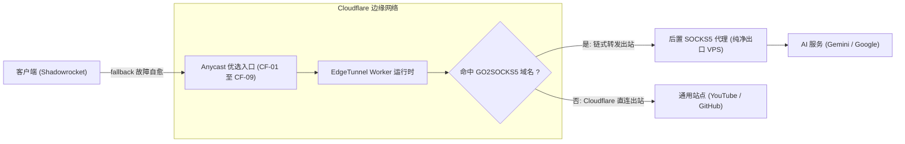

# Cloudflare Anycast 入口优选与 EdgeTunnel 链式出口架构

本项目维护 Cloudflare 优选入口列表与客户端分流配置。系统将网络入口握手与服务出站出口解耦，兼顾通用多媒体流量的速度与 AI 服务的出站可用性。



## 架构原理

系统在逻辑上划分为入口轨道与出口轨道。

### 1. 入口与出口解耦

客户端连接的是 Cloudflare 边缘的 Anycast 入口。外部目标网站（如 Gemini）识别的是 EdgeTunnel 发起出站连接时的出口 IP。

在默认情况下，EdgeTunnel 的流量直接从 Cloudflare 数据中心网段（ASN 13335）出站。Google 对云厂商机房 IP 实施严格的风控和人机拦截。单纯更换前端 Anycast 入口不能改变出站出口的归属。

双轨方案将两条链路独立配置。入口轨道使用 Anycast 优选 IP 降低握手延迟并避免运营商丢包。出口轨道通过 Worker 原生支持的链式代理，将 AI 业务转交至后置 SOCKS5 代理出站。

### 2. 本地链路与云端测速的差异

Anycast 路由由客户端所在的物理位置与运营商网络决定。云端测试机位于北美数据中心，测得的低延迟节点无法代表国内运营商线路的真实表现。

项目停用了每日定时扫描，避免不稳定的云端测试结果频繁改写客户端订阅。客户端配置采用 `fallback` 策略组。当选中的节点发生抖动时，客户端自动切换至下一个可用入口。

## 模块分布

- `scripts/verify_chain.py`。端到端验证工具，断言通用出站与 Gemini 出站的分流表现。
- `scripts/node_probe.py`。本地 sing-box 运行时管理、配置生成与传输基准测速。
- `scripts/update.py`。Cloudflare 官方 IP 网段抽样与候选节点筛选脚本。
- `scripts/exit_lookup.py`。查询 IP2Location 接口并比对出口国家与 ASN。
- `clients/shadowrocket.conf`。客户端配置文件，内置分流规则集与 `CF-故障切换` 策略组。
- `clients/README.md`。客户端导入与策略组说明。
- `ip.txt` 与 `global.txt`。静态固化的 Cloudflare 优选 Anycast 入口列表。

## 配置参考

### 1. EdgeTunnel 自定义域名

Cloudflare Pages 默认的 `*.pages.dev` 域名在国内受限，且直接通过 Anycast IP 携带该 SNI 握手会被边缘节点拦截。请在 Pages 控制台绑定自定义域名。

1. 在 Pages 项目的设置中选择「自定义域」。
2. 输入二级域名（例如 `vless.example.com`）。
3. 在 DNS 解析中添加对应的 CNAME 记录，指向你的 Pages 项目（例如 `your-project.pages.dev`），并开启代理状态。
4. 在 EdgeTunnel 管理后台将 Host 与 SNI 同步为该自定义域名。

### 2. EdgeTunnel 出口链式代理

在 Cloudflare Pages 或 Workers 的环境变量中添加出站代理：

| 变量名 | 必填 | 示例 | 说明 |
| :--- | :---: | :--- | :--- |
| **SOCKS5** | 可选 | `user:pass@198.51.100.1:1080` | 后置 SOCKS5 代理连接地址与凭据 |
| **GO2SOCKS5** | 可选 | `*google.com,*gemini.google.com` | 强制走后置代理的域名名单，英文逗号分隔 |

通用流量依然走 Cloudflare 边缘直出，享受无限流量带宽。

### 3. 客户端设置 (Shadowrocket)

1. 在「配置」页面选择远程文件 `clients/shadowrocket.conf`，点击「从 URL 更新」。
2. 确认首页顶部的「全局路由」设置为「**配置**」。
3. 首页将展示 `CF-故障切换` 分组。小火箭会根据健康检查结果自动选择延迟最低的节点。

### 4. 订阅更新建议

为避免频繁触发服务端的拉取日志与机器人通知，建议在 Shadowrocket 的「设置」->「订阅」中关闭「打开时更新」与「自动后台更新」。节点列表在本地长期稳定，无需频繁刷新。

## 验证与测试

运行全量单元测试：

```bash
python3 -m unittest discover -s tests -v
```

通过指定入口 IP 执行链路健康检查：

```bash
python3 scripts/verify_chain.py --ip 198.41.222.149
```
