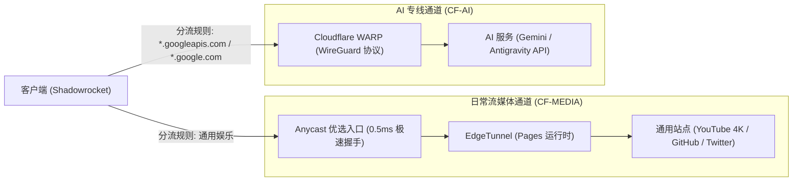

# Cloudflare Anycast 优选与客户端双轨解耦架构 (CF-MEDIA / CF-AI)

[中文](README.md) | [English](README_en.md)

本项目维护 Cloudflare 优选入口与客户端分流配置。系统在客户端实现业务通道解耦，兼顾通用流媒体与下载的极致速度，以及对风控敏感的 AI 业务（Gemini / Google / OpenCode Magpie）的高可用性。



## 架构核心原理

### 1. 业务通道完全解耦
- **`CF-MEDIA`（流媒体与日常娱乐主通道）**：
  通过国内至 Cloudflare 边缘仅 0.5ms 的 Anycast 优选入口接入，由部署在 Cloudflare Pages 上的 EdgeTunnel 直连出站。享受千兆低延迟与完全免费的无限流量，负责承载 99% 的大流量业务（YouTube 4K、Twitter/X、GitHub、海外下载等）。
- **`CF-AI`（AI 业务独立专线）**：
  Google Gemini 及 Google Cloud Code / Antigravity API 对云服务商机房 IP（如 Cloudflare ASN 13335 香港节点）有严格的地域封锁（`User location is not supported`）。本架构通过专属的个人版 WireGuard (Cloudflare WARP) 节点独立接管 AI 流量，以美区纯净个人 VPN 出口直连 Google，彻底杜绝 400 拒绝服务与页面卡死。

### 2. 告别云端扫描与频繁抖动
- **停用云端 Actions 定时扫描**：云端测试机位于海外数据中心，无法真实反映国内运营商线路质量，且定时刷新会导致长连接中断。本项目固化本地实测最优的极速入口。
- **静态直连取代频繁轮询**：策略组采用直接绑定的 `select` 模式，消除了原多节点心跳探测引起的连接池横跳与 502 网关错误。

## 仓库结构与模块

- `ip.txt` 与 `global.txt`。本地实测固化的极速 Anycast 入口（`CF-MEDIA`）。
- `clients/shadowrocket.conf`。客户端配置文件，内置分流规则集、`日常流媒体` 与 `AI-专线` 策略组。
- `clients/README.md`。客户端配置导入与使用指引。
- `scripts/verify_chain.py`。本地端到端验证工具，断言通用出站与 Gemini 出站的分流表现。
- `scripts/node_probe.py`。本地 sing-box 运行时管理与真实传输吞吐压测工具。
- `scripts/update.py`。Cloudflare 官方 IP 网段抽样与本地候选节点筛选脚本。
- `scripts/exit_lookup.py`。查询 IP2Location / IPPure 接口并比对出口国家与 ASN。

## 客户端设置 (Shadowrocket)

1. 在「配置」页面选择远程文件 `clients/shadowrocket.conf`，点击「从 URL 更新」。
2. 确认首页顶部的「全局路由」设置为「**配置**」。
3. 首页展示两大分组，实现全自动分流：
   - **`日常流媒体`**：自动接入 `CF-MEDIA`，负责所有娱乐与通用网络流量。
   - **`AI-专线`**：自动接入 `CF-AI`，负责 Gemini 网页版与本地 OpenCode / Magpie 对话。

## 本地验证与测试

运行全量单元测试（30 项核心断言全部通过）：

```bash
python3 -m unittest discover -s tests -v
```

通过指定入口 IP 执行链路健康检查：

```bash
python3 scripts/verify_chain.py --ip 104.16.39.201
```
