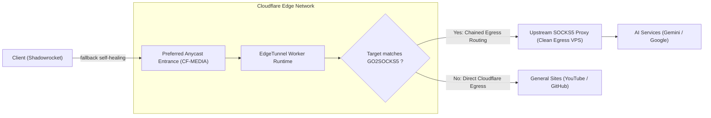

# Cloudflare Anycast preferred entrances and EdgeTunnel egress architecture

[English](README_en.md) | [中文](README.md)

This project maintains Cloudflare preferred Anycast entrance lists and client routing rules. The architecture decouples entrance TLS handshakes from outbound egress routing. This design maintains low latency for general traffic while keeping AI services reachable through clean egress routes.



## Architectural concepts

The system splits proxy traffic into two independent paths.

### 1. Decoupling entrances from exits

Your client connects to Cloudflare's Anycast edge IP. External destinations such as Google Gemini inspect the public IP address that EdgeTunnel uses when creating outbound connections.

By default, EdgeTunnel routes all outbound traffic directly through Cloudflare's data center network (ASN 13335). Google enforces strict bot detection and CAPTCHA challenges on cloud provider data center IP ranges. Changing the Anycast entrance address does not alter the egress IP range.

The dual-track approach configures the two network hops separately. The entrance hop uses preferred Anycast IPs to lower handshake latency and minimize ISP packet loss. The egress hop forwards AI traffic to an upstream SOCKS5 proxy using EdgeTunnel's built-in routing rules.

### 2. Disparity between local networks and cloud scans

Anycast routing depends on your physical location and local internet service provider. Automated cloud test runners operate in North American data centers. Low-latency results from an overseas test runner do not reflect connection quality on local home networks.

This repository disables automated daily scans. This prevents fluctuating remote scan results from constantly modifying local client subscriptions. The client configuration uses a `fallback` proxy group instead. When the primary entrance drops packets, the client switches to the next available entrance within 5 seconds.

## Repository layout

- `scripts/verify_chain.py`. End-to-end verification script that validates general and Gemini egress paths.
- `scripts/node_probe.py`. Manages the local sing-box test runtime, configuration generation, and transfer benchmarks.
- `scripts/update.py`. Samples Cloudflare official IPv4 CIDR ranges and checks candidate entrances.
- `scripts/exit_lookup.py`. Queries IP2Location to cross-check exit country and ASN data.
- `clients/shadowrocket.conf`. Shadowrocket configuration file with ad blocking, `日常流媒体` (daily streaming) and `AI-专线` (dedicated AI) routing.
- `clients/README.md`. Setup guide for client configuration imports and proxy groups.
- `ip.txt` and `global.txt`. Static preferred Cloudflare Anycast entrance (`CF-MEDIA`).

## Configuration reference

### 1. Bind a custom domain in EdgeTunnel

Cloudflare Pages assigns default `*.pages.dev` subdomains that face network restrictions in some regions. Cloudflare edge nodes also reject direct Anycast connections that send a default Pages hostname during TLS negotiation. You must attach a custom domain to the Pages project.

1. Open the Cloudflare dashboard and navigate to your Pages project.
2. Select **Settings**, then open **Custom domains**.
3. Add a subdomain under an active Cloudflare zone, such as `vless.example.com`.
4. Create a CNAME record in DNS for the subdomain pointing to your Pages project (for example, `your-project.pages.dev`), and enable the proxy status.
5. Update the host and SNI fields in the EdgeTunnel administration panel to match this custom domain.

### 2. Configure upstream SOCKS5 egress in EdgeTunnel

To improve Gemini reachability, add these two environment variables in your Cloudflare Pages or Workers project settings:

| Variable | Required | Example | Description |
| :--- | :---: | :--- | :--- |
| **SOCKS5** | Optional | `user:pass@198.51.100.1:1080` | Upstream SOCKS5 proxy server address and credentials |
| **GO2SOCKS5** | Optional | `*google.com,*gemini.google.com` | Comma-separated domain wildcard list forced through the upstream proxy |

General web traffic bypasses the upstream proxy and routes directly through Cloudflare's edge network with unmetered bandwidth.

### 3. Client configuration (Shadowrocket)

1. Open Shadowrocket and select the **Config** tab.
2. Under remote files, select `clients/shadowrocket.conf` and tap **Update from URL**.
3. Return to the home screen and verify that **Global Routing** is set to **Config**.
4. The proxy group list displays `日常流媒体` and `AI-专线`. The client automatically routes media and AI traffic through optimal paths.

### 4. Subscription update recommendations

EdgeTunnel emits a `#Get_SUB` log entry to its Telegram bot whenever a client fetches subscriptions.

To prevent frequent notification alerts, open Shadowrocket **Settings**, select **Subscribe**, and turn off both **Update on open** and **Auto background update**. The static entrance list remains reliable over long periods and does not require daily refreshes.

## Verification and testing

To run the unit test suite:

```bash
python3 -m unittest discover -s tests -v
```

To run an end-to-end chain verification against an entrance IP:

```bash
python3 scripts/verify_chain.py --ip 198.41.222.149
```
